<!-- esp32-s3-ws4-caravan-mini v1.0 -->
# esp32-s3-ws4-caravan-mini

**Version 1.0** - the first release of the mini firmware. What changed in each version is in [CHANGELOG.md](CHANGELOG.md).

[](LICENSE.md) Free for non-commercial use - see [License](#license). Written with the help of Claude (Anthropic's AI).

See **[BOARD_NOTES.md](BOARD_NOTES.md)** for hard-won notes about this board: SD card wiring, memory limits, LVGL 8 pitfalls and the BLE protocols used here.


Caravan display for the **Waveshare ESP32-S3-Touch-LCD-4 (V4)**, the 480×480 touch board with the CH32V003 IO expander. Built with Arduino and LVGL 8.

**The mini version** of [esp32-S3-ws4-caravan](https://github.com/fredrikrudin/esp32-S3-ws4-caravan):
the same display without relays, Shelly devices, schedules and the ECO-WORTHY battery BMS.
What is left is Victron (battery, solar, chargers, inverter), RuuviTags, the weather and the
web page, with less code, fewer Bluetooth connections and more free memory, so it runs steadily
while the bigger firmware's switching features mature. Both use the same settings in flash: Victron
devices, RuuviTags, WiFi and the web password carry over in either direction.

## Screens

| | |
|---|---|
|  | 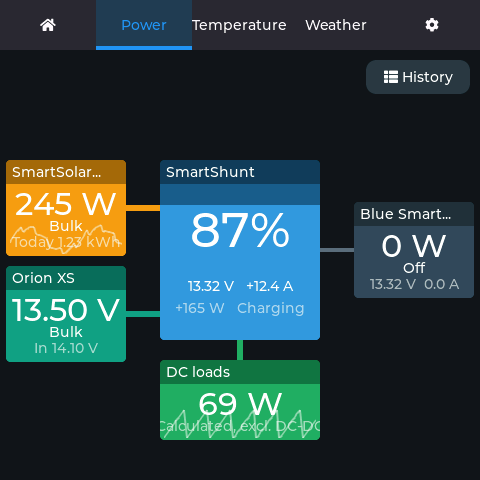 |
| **Home** – clock between battery and solar gauges, ten-minute graphs under each, the RuuviTags below (temperature over name), weather symbol and outside temperature top left, WiFi signal top right | **Power** – the battery in the middle, chargers left, AC side right, DC loads below; each connection lights up in its own colour while energy flows |
| 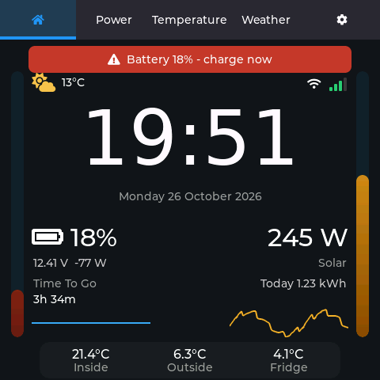 | 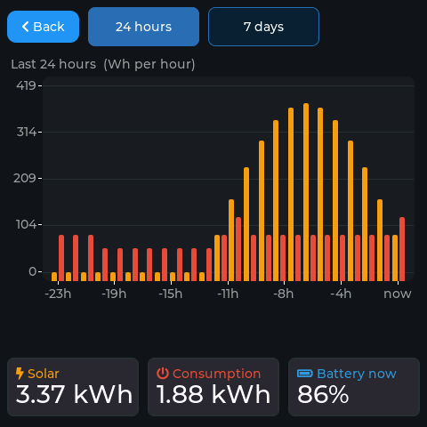 |
| **Warnings and alarms** – a banner on Home, orange for warnings and red for alarms | **History** – solar and consumption per hour or per day, reached by tapping a Power tile |
| 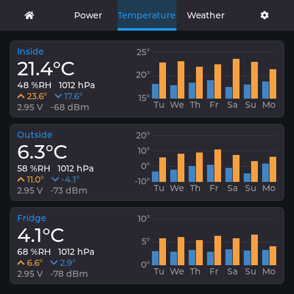 | 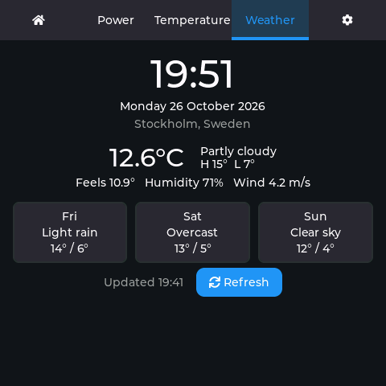 |
| **Temperature** – each RuuviTag with its reading and the last 7 days: daily low in blue, high in orange | **Weather** – now, today's high and low, and three days ahead; updated hourly, or now with Refresh |
| 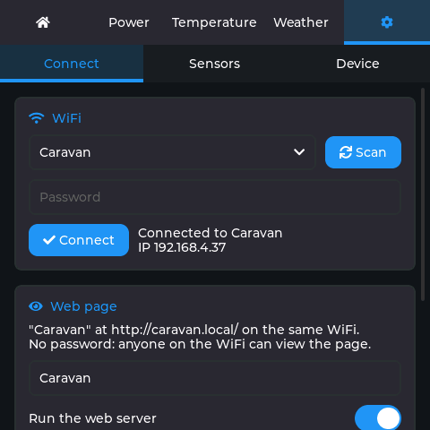 | 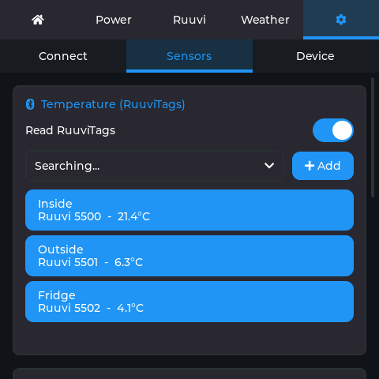 |
| **Settings → Connect** – WiFi, the web page and the weather location | **Settings → Sensors** – RuuviTags, Victron devices and the scan interval |
| 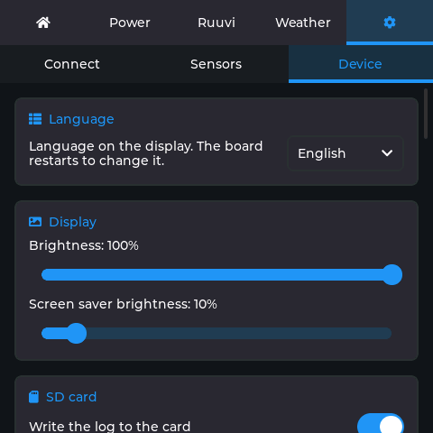 | 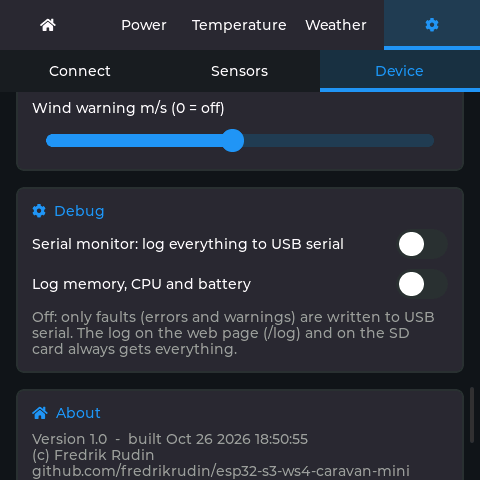 |
| **Settings → Device** – language, display, power, alarms, SD card | **Settings → Device → Debug** – the serial monitor switch and the performance log |
| 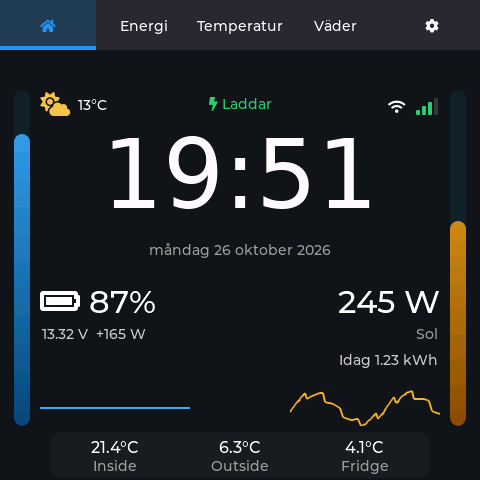 | |
| **På svenska** – the same screens in Swedish | |

*Screenshots rendered by the firmware's own UI code with LVGL on a PC, with example data
(`tools/screenshots`).*

## Features

| Tab | What it shows |
|---|---|
| **⌂ Start** | Large clock and date between two gradient gauges: battery on the left with Time To Go, solar on the right. Ten-minute graphs under each, then up to three RuuviTags along the bottom, each with its temperature over its name. Top left a weather symbol (sun, moon, clouds, rain, snow, fog, thunder; day or night by today's sunrise and sunset) with the outside temperature, opposite the WiFi signal. A warning banner appears across the top when something needs attention |
| **Power** | The battery in the middle, chargers on the left, the AC side on the right, DC loads below. Each connection lights up in its device's colour while energy flows, and the solar, battery and loads tiles carry a ten-minute graph. Tap any tile, or the **History** button top right, for the history: solar and consumption per hour over 24 hours, or per day over 7 days |
| **Temperature** | Up to 3 named RuuviTags: temperature, humidity, pressure, tag battery and signal, and a chart of the last 7 days per tag: each day's low (blue) and high (orange), in the colours of Victron VRM. The 7-day high and low sit under the reading. The history is kept in flash, so it survives a restart |
| **Weather** | Current conditions, high and low, feels-like, humidity, wind and a 3-day forecast (Open-Meteo). Fetched every hour while the screen is awake, never while the screen saver is on (it catches up as soon as the screen wakes), and at once with the **Refresh** button. A failed fetch is tried again after a minute |
| **⚙ Settings** | Three sub-tabs: Connect, Sensors, Device |

**Not in the mini**: relays, Shelly devices, schedules and the battery BMS. The battery figures
come from a Victron battery monitor (SmartShunt, BMV, Lynx BMS); without one, Home and the web
page say "No data" for the battery and solar still works.

**Warnings and alarms** appear as a banner on the Start page and at the top of the web page:
battery SOC below your thresholds, battery voltage out of range, inverter alarms, a Victron
device gone quiet, WiFi lost, strong wind, and optionally the SD card. Thresholds are under Settings → Device → Alarms, and a new alarm can wake the screen.

**Running on the onboard battery**: with a LiPo fitted and the setting switched on, losing
external power turns the display into a local instrument: WiFi off, Bluetooth listening once every 5 minutes, the screen dimmed until touched,
the last readings kept on screen and a "Running on battery" banner along the
bottom. At your threshold it closes the log, unmounts the card and sleeps.

**Screen saver**: after 30 s without touch, a 96-pixel clock and an SOC bar on a dimmed screen.

## Settings

Settings has its own row of tabs, so no page is more than a couple of screens long.
Each page is a column of cards.

| Page | Cards |
|---|---|
| **Connect** | **WiFi** (scan, password, status) &middot; **Web page** (run the server, name, password) &middot; **Weather location** |
| **Sensors** | **Temperature** (up to 3 RuuviTags) &middot; **Victron devices** (add, name, encryption key, live status) &middot; **Sensor scan interval** (and Scan now) |
| **Device** | **Language** (English, Svenska) &middot; **Power** (onboard LiPo, battery mode and its shutdown threshold) &middot; **Display** (brightness, screen saver brightness) &middot; **Alarms** (thresholds, wake the screen, SD warning) &middot; **SD card** (mount, eject, probe, logs, CSV, backup) &middot; **Debug** (serial monitor, performance log) &middot; **About** &middot; **System** (restart, shut down, full reset) |

Temperature has an on/off switch: switching it off also stops decoding RuuviTags and takes the
Temperature tab off the tab bar.


## Language

The display speaks **English** (the default) or **Swedish**, chosen under Settings → Device →
Language. Changing it restarts the board, which takes a few seconds. Both are built into the
firmware, so no SD card is needed. The web page follows the same language: its own texts come from `/lang` (the page's
`T("...")` texts, translated in the same `.po` files), and the texts in `/json` (date, weather,
Victron status, warnings) are sent in it. The numbers and field names in `/json` never change
with the language.

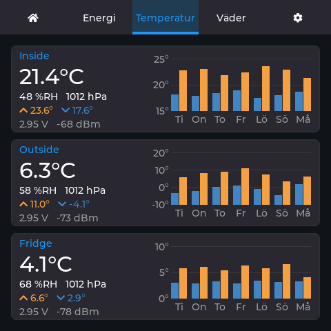

Translations are ordinary gettext `.po` files in `lang/`, so they can be edited with
[Poedit](https://poedit.net/), and new languages can be added the same way. See
[`lang/README.md`](lang/README.md).

## Screen saver

To adjust the look, change these lines at the top of `ui_saver.cpp`:

```cpp
#define SAVER_BAR_BG 0x202020     // empty part of the SOC bar
#define SAVER_LOW_COLOR 0x702020  // bar color at low SOC (dim red)
#define SAVER_LOW_SOC 20          // below this % the bar turns red
```

**Warnings and alarms** appear as a banner on the Home page and at the top of the web page: battery SOC below your thresholds, battery voltage out of range, inverter alarms, a Victron device gone quiet, WiFi lost, strong wind and SD card trouble. Thresholds are set under Settings → Alarms, and a new alarm can wake the screen saver.

A **web page** shows everything on the display. At the top is **Power**, laid out like the display's Power tab: chargers on the left, the battery monitor in the middle, the AC side on the right and the DC loads below, with lines that light up and move while energy flows. Below it are the temperatures and the weather side by side, then the charts of the last 24 hours and 10 minutes, the warnings and the board battery. It only shows; nothing can be switched from it. Open **`http://caravan.local/`** (or the board's IP, shown under Settings → WiFi) on a phone, tablet or computer on the same WiFi. The page adapts to the screen: one column on a phone, two or three on a tablet or PC. It is one fixed file that the browser keeps; after that it fetches `/json` every 30 seconds (every 2 minutes once left alone; **Update** fetches at once) and draws itself, so the board does little work per update. If the board doesn't answer, the page says so and keeps the last values. The same data is available to scripts and Home Assistant at `/json`, and the recent log at `/log`. `sh tools/webpreview/build.sh` runs the page on a PC with example data (add `sv` for Swedish).

The web server can be switched off entirely under **Settings → Connect → Web page**, which frees
the memory the page building uses. Otherwise, under **Settings → Web page** you can name the page (default "Caravan") and set a password; the page then asks for it once (the login lasts 30 days, or until the board restarts or the password changes). Scripts can use `/json?key=<password>`. Leave the password empty for no login. The page uses plain HTTP, so the password keeps casual visitors on the same WiFi out, but is not strong security. The address follows the name: a page called "Cabby 620" is at `http://cabby-620.local/` (lower case, spaces become dashes, å ä ö become a a o). Without a name it is `caravan.local`, set by `MDNS_NAME` in `app.h`.

After 30 seconds without touch, a screen saver shows a dim clock and lowers the backlight. A tap wakes it.

## Version numbers

The version is `FW_VERSION` in `app.h`. It is shown under Settings → Device → About, on the
web page and in the first log line, and every file carries it on its first line as a comment
(`// esp32-s3-ws4-caravan-mini v1.0`). To change it everywhere at once:

```
python3 tools/set_version.py 1.1
```

Run it without a number after adding a file, to tag the new file with the current version.
Every change gets an entry in [CHANGELOG.md](CHANGELOG.md).

## Getting started

1. Install the libraries and set the Arduino IDE options listed below.
2. Open `esp32-s3-ws4-caravan-mini.ino` and upload.
3. On the board, open **⚙ Settings**:
   - **WiFi:** tap Scan, pick your network, enter the password, tap Connect.
   - **Weather location:** type a city (or `City, Country`) and tap Set.
   - **RuuviTags:** pick a tag from the list, tap Add and give it a name. Up to 3 tags; tap one in the list to rename or delete it.
   - **Victron devices:** pick a device, tap Add, then enter a name and its 32-character encryption key.

The Serial Monitor (115200 baud) shows faults only by default; switch on Settings → Device → Debug → Serial monitor to see startup, free memory, WiFi and weather lookups as well.

## Files

Everything is in one flat folder. `app.h` holds the shared configuration, data types and declarations; each `.cpp` file is one module.

| File | Contents |
|---|---|
| `esp32-s3-ws4-caravan-mini.ino` | `setup()` and `loop()` |
| `app.h` | Configuration, data types, shared state, module functions |
| `state.cpp` | Shared state, loading settings, small helpers |
| `sdlog.cpp` | Logging to Serial, to a memory buffer (web `/log`) and to the TF card |
| `watchdog.cpp` | Restarts the board if the main loop hangs, and logs where it was stuck |
| `datalog.cpp` | Measurements as CSV, settings backup and restore |
| `board.cpp` | Display, touch, IO expander, LVGL driver, backlight |
| `net.cpp` | Network task: WiFi, NTP, weather, all flash writes |
| `web.cpp` | Web pages and data: `/`, `/json`, `/lang`, login, log, files |
| `web_http.cpp`, `web_http.h` | The web server: several connections at once, never makes the loop wait |
| `web_page.h` | The web page (HTML, CSS, JavaScript) that draws itself from `/json` |
| `web_page_gz.h` | The same page compressed, as the board sends it. Made by `python3 tools/web_gz.py`: run it after editing `web_page.h` |
| `ble.cpp` | Bluetooth scanning |
| `ruuvi.cpp` | RuuviTag decoding |
| `victron.cpp` | Victron decryption and decoding |
| `sw6106.cpp` | Power bank controller keep-alive, where fitted |
| `ui_common.cpp` | Tabs, keyboard, widget helpers, timers |
| `ui_home.cpp` | Home tab (start page) |
| `ui_power.cpp` | Power tab |
| `history.cpp` | Energy history: hourly and daily totals |
| `ui_history.cpp` | History screen (bar chart, opened from the Power tab) |
| `ui_temp.cpp` | Temperature tab (RuuviTag cards with a 7-day chart each) |
| `ruuvi_hist.cpp` | Daily low and high per RuuviTag for the last 7 days, kept in flash |
| `ui_weather.cpp` | Weather tab and clock |
| `ui_settings.cpp` | Settings tab (WiFi, location, RuuviTags, display, scan interval) |
| `ui_victron_settings.cpp` | Victron device settings |
| `ui_saver.cpp` | Screen saver |
| `font_clock_96.c` | 96 px clock font for the screen saver (digits, `:` and `-`) |
| `font_weather.c` | The start page's weather symbols, 24 px, from Font Awesome Free (`tools/gen_font_weather.py`) |
| `lang.cpp` | Language: looks texts up in the built-in translations, swaps in the Latin-1 fonts |
| `lang_tables.h` | The built-in translations, generated from `lang/*.po` by `tools/i18n.py` |
| `font_latin1.c` | The Latin-1 letters (å ä ö é ü ...) missing from LVGL's built-in fonts, used when translated |
| `lang/` | `caravan.pot` (the texts to translate) and one `.po` file per language |
| `tools/` | `i18n.py` (template and built-in tables), `gen_font_latin1.py` (the fonts), `set_version.py` (the version, everywhere), `screenshots/` (the README images, rendered on a PC) |
| `screen-*.png` | Screenshots for this README, rendered by `tools/screenshots` |
| `memory.md` | Notes and plan for lowering memory use and latency |
| `CHANGELOG.md` | What changed in each version |
| `lv_conf.example.h` | LVGL settings that suit this board and PSRAM-less boards alike |

## Libraries

- **lvgl 8.x** (with the `lv_conf.h` from Waveshare's examples)
- **GFX Library for Arduino 1.6 or later** (Library Manager; tested with 1.6.9). Strongly
  recommended over Waveshare's bundled 1.5.3, which always takes 77 kB of internal RAM for the
  display's bounce buffers. With 1.6 the firmware sets them to 10 lines and about 58 kB more is
  free. The boot log says which: `Internal heap after display init: … (bounce buffers 10 lines)`.

  Measured on the board (esp32-s3-ws4-caravan-mini, from the boot log):

  | | GFX 1.5.3 | GFX 1.6.9 |
  |---|---|---|
  | Internal RAM after display init | 174 kB | 232 kB |
  | Free after WiFi connected | 45 kB | **104 kB** |
  | Largest free block | 32 kB | **61 kB** |

  More free internal RAM is what keeps the web server, Bluetooth and the weather lookups
  reliable. If the picture ever shifts down after the update, see Troubleshooting.
- **SensorLib** and **WS_CH32_IO**: the versions bundled with Waveshare's ESP32-S3-Touch-LCD-4 examples
- **ArduinoJson** v7
- **NimBLE-Arduino** by h2zero, 2.5.2 or later (tested with 2.5.2). Updating it replaces
  `src/nimconfig.h`; the firmware needs nothing changed there

## ESP32-S3-Touch-LCD-4 Library file installation instructions

Waveshare's own instructions for this board and their example sketches. **This firmware
needs the libraries listed under [Libraries](#libraries) instead**: it uses GFX Library for
Arduino, SensorLib and WS_CH32_IO, because the V4 board has the CH32V003 chip rather than
the TCA9554 expander. The table is here because `lvgl` and `lv_conf.h` are shared, and the
offline copies below are the versions this board is tested with.

| Library Name | Description | Version | Library Installation Requirements |
|---|---|---|---|
| ESP32_Display_Panel | ST7701, GT911 driver library | v0.1.8 | "Install Online" or "Install Offline" |
| ESP32_IO_Expander | TCA9554 IO expansion chip driver library | v0.0.4 | "Install Offline" (return value of IOExpander_Library changed) |
| lvgl | LVGL graphical library | v8.4.0 | "Install Online" requires copying the demos folder to src after installation. "Install Offline" is recommended |
| lv_conf.h | LVGL configuration file | —— | "Install Offline" |

The libraries to install offline are in Waveshare's repository:
<https://github.com/waveshareteam/ESP32-S3-Touch-LCD-4/tree/main/examples/arduino/libraries>

## Arduino IDE settings

- Board: ESP32S3 Dev Module
- **PSRAM: OPI PSRAM** (the display framebuffer and LVGL buffers live there)
- **Erase All Flash Before Sketch Upload: Disabled**, otherwise every upload wipes the saved settings

⚠️ **`lv_conf.h` is shared by every sketch on your machine.** A copy written for a board
without PSRAM (a small pool in internal RAM) will make this firmware run out of memory while
building the UI and crash with `LoadProhibited`. `lv_conf.example.h` in this repository
chooses the right pool automatically from `BOARD_HAS_PSRAM`, so it suits both this board and
boards without PSRAM; copy it to `<Arduino>/libraries/lv_conf.h`. The boot log prints the pool
size and warns if it ends up in the wrong place.

Optional, in `lv_conf.h`:

- Enable `LV_FONT_MONTSERRAT_32` and `LV_FONT_MONTSERRAT_48` for a large clock and temperatures
- To free internal RAM, move LVGL's memory pool to PSRAM:
  ```c
  #define LV_MEM_POOL_INCLUDE <esp32-hal-psram.h>
  #define LV_MEM_POOL_ALLOC ps_malloc
  ```

## Logging

Everything the firmware logs goes to a 24 kB buffer in PSRAM that you can read in a browser
at `/log` without attaching a computer, and to the TF card when that is switched on.

**USB serial (Arduino's Serial Monitor):** off by default, and then only faults are written
there: errors and warnings, such as an SD card that can't be found, a lost WiFi connection, a
touch controller that didn't answer, low memory or a battery shutdown. Switch on
**Settings → Device → Debug → Serial monitor** to see everything as well: the boot figures,
memory, connections and sensor details. The switch is saved, and it is read first thing at
start-up, so the boot lines follow it too. ESP-IDF's own messages follow it as well: errors
only when it's off, warnings too when it's on. The same section has **Log memory, CPU and
battery**, a status line every few seconds for chasing memory or stack problems.
Switch on **Settings → SD card** to also append everything to `/caravan.log` on the TF card
(SPI: GPIO2 clock, GPIO1 MOSI, GPIO4 MISO). The file is flushed every 5 seconds. The same section has Mount, Eject, New log and Delete old logs, plus card type and free space. Log files can be listed and downloaded in the browser at `/files`.

**Measurements as CSV:** switch on "Log measurements" to append a line to `/data.csv` every 1, 5, 15 or 60 minutes: time, SOC, battery voltage/current/power, solar power and yield, the three RuuviTag temperatures and outside temperature. A `data.csv` with other columns (written by the full caravan firmware) is renamed `data-old.csv` first, so the columns always match the header. Download it from `/files` and open it in a spreadsheet.

**Running on the onboard battery:** with a LiPo in the board's connector and "Keep running on the
battery" switched on under Settings → Device → Power, losing external power turns the display into
a local instrument: WiFi off, Bluetooth
listening once every 5 minutes so the readings stay current, the screen dimmed until touched and a "Running on battery" banner along the bottom with the charge left. At the threshold
you set (20% by default) it closes the log, unmounts the card and sleeps. Plugging power back in
restarts the board so both radios come up cleanly. A 1200 mAh cell lasts roughly 10–15 hours.

**Restart, shut down, full reset:** the System section at the end of Settings. Each asks for confirmation. Shutting down puts the board into deep sleep with the backlight off; the reset button wakes it. A full reset erases every setting, so back up to the card first.

**Settings backup:** "Back up settings" writes everything to `/settings.json` on the card, including WiFi and Victron encryption keys, so keep the card safe. "Restore" reads it back and restarts the board, which is the quick way back after an accidental flash erase.

## Hardware notes

- **Backlight** PWM comes from the CH32V003 and is inverted on this board (0 = full brightness, 255 = off). This is handled in `set_backlight()`.
- **TF card**: on the V4 board the slot works over **SPI** (SCK GPIO2, MOSI GPIO1, MISO GPIO4), with chip select handled on the board. Waveshare's own `10_LVGL_SD` example uses SD_MMC and does not work on this revision (error `0x107`, `send_op_cond` timeout). Settings → SD card → **Probe card** tries both modes and every expander bit if a card is ever not found.
- **Victron**: enable *Instant readout via Bluetooth* in VictronConnect and copy the encryption key from *Product info*.
- **Bluetooth**: the mini only listens. Victron and RuuviTag data come from advertisements, so the board never connects to or pairs with anything.
- **Weather** uses plain HTTP. HTTPS needs about 40 kB of internal RAM in one piece, which GFX Library 1.5.3 leaves no room for; with 1.6 there is room (61 kB largest block), but plain HTTP works and keeps that memory for the rest.

## Troubleshooting

| Problem | Likely cause |
|---|---|
| Settings are gone after an upload | *Erase All Flash Before Sketch Upload* is enabled |
| City lookup or weather fails | Check the `HTTP` and `Internal heap` lines in the Serial Monitor (failed requests are always shown). Low free RAM breaks network requests |
| Victron device shows "Wrong key" | Key mistyped, or it changed in VictronConnect |
| Victron device shows "No signal" | Out of range, or Instant readout switched off |
| Image shifted down (tab bar too low) | The RGB panel lost sync, usually at startup or under heavy load. Press reset. The pixel clock is 10 MHz and the panel uses bounce buffers (`BOUNCE_LINES` in `board.cpp`, 10 lines with GFX Library 1.6 or later). If it happens often, set `BOUNCE_LINES` to 20: still about 40 kB less than GFX 1.5.3 |

## License

Copyright (c) 2026 Fredrik Rudin. Licensed under
[Creative Commons Attribution-NonCommercial 4.0 International (CC BY-NC 4.0)](https://creativecommons.org/licenses/by-nc/4.0/):
you may use, share and change it for non-commercial purposes, with credit to the author.
Selling it, or devices running it, needs the author's permission. Details and the
third-party licenses are in [LICENSE.md](LICENSE.md).

This code was written with the help of **Claude**, an AI model by
[Anthropic](https://www.anthropic.com), under the author's direction and tested on the
real hardware by the author.
